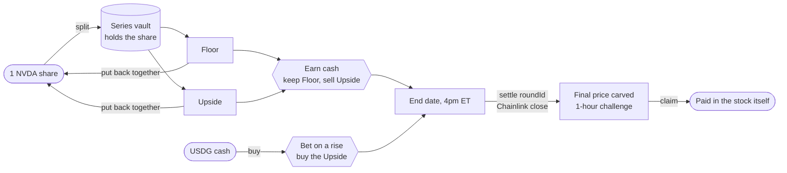
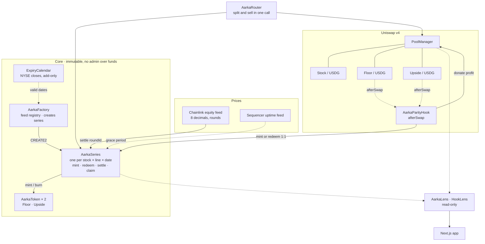

<div align="center">

# 🌗 Aarka

### Split a tokenized stock into a Floor and the Upside.

**One share in, two tokens out.** The Floor keeps the share's value up to a price line. The Upside
gets everything above it. Keep one and sell the other: earn cash on shares you hold, or bet on a
rise for a fraction of a share. No borrowing, so nothing can ever be liquidated. Built on
**Robinhood Chain**, priced by **Chainlink**, traded on **Uniswap v4**.


🌐 **[Live app](https://aarka-app.vercel.app)** · 🧭 **[How it works](https://aarka-app.vercel.app/how)** · 🛡 **[Audit](AUDIT.md)** · 📄 **[Architecture](ARCHITECTURE.md)**

**[11 series settled](#proven-on-testnet)** against Chainlink closes · **4** parity restorations, **$3,655** paid to LPs · **0** liquidations possible

</div>

---

## The problem

A tokenized stock is a share you can only hold or sell. The two things stock holders actually do
with options, **sell the growth they don't expect** (a covered call) or **buy the growth they do
expect** (a call), need an option writer on the other side, margin, and on-chain, a weekly auction
into a handful of market makers. Aarka needs none of it.

## What Aarka is

A vault that splits one share into two ERC-20s at a fixed **line** (the strike) and **end date**:

| Token | Pays at the end, per token | Behaves like |
| --- | --- | --- |
| **Floor** `fNVDA-210-30OCT26` | `min(P, K) / P` of a share | The share, capped at the line |
| **Upside** `uNVDA-210-30OCT26` | `max(P − K, 0) / P` of a share | A call on the share above the line |

- **Floor + Upside = 1 share at every price.** So the vault is always exactly solvent, with no option writer and no counterparty.
- **Always reversible.** One of each always turns back into one share: before the end date, after it, or with a dead oracle.
- **Every split settles.** Against a specific Chainlink round, with a one-hour challenge and a late path, so nobody is ever stranded.
- **The AMM is the market.** Each half trades against USDG on Uniswap v4, and a hook keeps `P(Floor) + P(Upside) = P(share)`.

## User flow



Split, rejoin, buy, sell, and *keep one, sell the other* in a single transaction are all in the
[app](https://aarka-app.vercel.app/app), with free practice shares and cash on testnet.

## Architecture



Everything outside **Core** is replaceable without touching a series: the router, the hooks and
the lenses have all been redeployed on testnet while the same series kept running.

## How it works

**Payoff.** `floor = mulDiv(min(P, K), 1e18, P)` rounded down, and `upside = 1e18 − floor`
computed as the exact complement, so the two always sum to one share by construction. Claims burn
first and round down, leaving dust in the vault. Mint counts the vault's balance delta, so it stays
exact even for a fee-on-transfer token.

**Settlement.** `settle(roundId)` names a Chainlink round and the contract proves it is the right one:
`updatedAt ≤ expiry`, no more than 26 hours old (the feed's 24-hour heartbeat plus margin), and round
`id + 1` either doesn't exist (a phase boundary, caught) or is after expiry. The normal path also
requires the L2 sequencer to have been up for an hour, the stock not to be oracle-paused, and no
ERC-8056 corporate action after the round. For one hour a strictly later qualifying round can replace
the price, then claims open. If the normal path stays impossible for 7 days, the last round before
expiry is accepted at any age, so **every series resolves**.

**Parity hook.** On every swap in a hooked pool, `afterSwap` compares `P(Floor) + P(Upside)` with
the share pool. Past 100 bps (above the ~90 bps that three pool fees cost) it binary-searches, in 20
steps, for the size where the two meet. That is also the profit-maximising size. The size is capped
by `maxArbSize`, half the virtual reserve and the PoolManager's real balance. It then trades inside the
same unlock with flash accounting: halves dear, so buy the share, split it and sell both; halves
cheap, so buy both, rejoin and sell the share. The arb runs in a self-call wrapped in try/catch and
must end with positive profit and every currency delta flat, so a failed arb never touches the
user's swap. Profit is donated to the in-range LPs, and new liquidity must stay for an hour, so it
can't be sniped just in time.

**Governance.** Anyone can create a series for any whole-cent line within 5× of spot and any date on
the published calendar. The one governed input is which Chainlink feed prices each stock, and changing
it reaches only series created afterwards. No proxies, no upgrades, no pause on user funds, no price
override.

## Proven on testnet

All on Robinhood Chain testnet, against stock and USDG stand-ins and feeds that copy the real
mainnet Chainlink prices with their original timestamps.

**Settled against the Chainlink close**, by anyone calling `settle`:

| Split | Close | Floor / Upside per token |
| --- | --- | --- |
| NVDA $215 · 4 Sep | $230.24 | 93.38% / 6.62% |
| NVDA $215 · 11 Sep | $219.48 | 97.96% / 2.04% |
| NVDA $240 · 11 Sep | $219.48 | 100% / 0% |
| NVDA $210 · 25 Sep | $225.66 | 93.06% / 6.94% |
| NVDA $230 · 25 Sep | $225.66 | 100% / 0% |
| TSLA $350 · 25 Sep | $371.75 | 94.15% / 5.85% |
| TSLA $400 · 25 Sep | $371.75 | 100% / 0% |
| NVDA $210 · 2 Oct | $235.00 | 89.36% / 10.64% |
| NVDA $230 · 2 Oct | $235.00 | 97.87% / 2.13% |
| TSLA $350 · 2 Oct | $370.45 | 94.48% / 5.52% |
| TSLA $400 · 2 Oct | $370.45 | 100% / 0% |

**The parity hook, live.** A $50,000 Floor buy on NVDA $210 · 30 Oct: in the same transaction the
hook bought and split 215.21 shares, sold both halves, closed the gap back to 1 bps and paid
**$1,246.33** to LPs.
[`0xaf2a55d1…`](https://explorer.testnet.chain.robinhood.com/tx/0xaf2a55d1ad02fe7e6fd9139337ffdd792c6f0f0a8dc65c88b093bab4d4b23101)
Across every hook so far: 4 restorations, 680.96 halves, $3,655.56 to LPs.

**Every user action, end to end:**

| Action | Transaction |
| --- | --- |
| Split 1 NVDA into Floor + Upside | [`0x1b63919c…`](https://explorer.testnet.chain.robinhood.com/tx/0x1b63919cc3f4e340ca67d21d6e7f78b626d8b778141eebe55c9711a27365078d) |
| Put a pair back together | [`0x84dac2dd…`](https://explorer.testnet.chain.robinhood.com/tx/0x84dac2ddb8382739c8086a6c3535d00f74df59edd0de933666705e4cc7ccdb2f) |
| Keep the Floor, sell the Upside, one call | [`0xce052e40…`](https://explorer.testnet.chain.robinhood.com/tx/0xce052e40136c1866ff765f210c80b1fea4b9dc2732b970bd5ca65a8ca2aa212c) |
| Buy a Floor with cash, then sell it | [`0x1aa92d98…`](https://explorer.testnet.chain.robinhood.com/tx/0x1aa92d98fb614d67a1789d3a60cd7b47a0279530027209f4d79dcc97eedf9636) · [`0xf43d3d97…`](https://explorer.testnet.chain.robinhood.com/tx/0xf43d3d97b831f6b6b816939c691032ee3299c062337a7d85d53d8b58fead3476) |
| Settle NVDA $210 · 25 Sep at $225.66 | [`0x59239983…`](https://explorer.testnet.chain.robinhood.com/tx/0x592399839b33e9e821ddaa330a8816b77331eb56c5ff2534d95afc41cbb7a58d) |
| Collect: 2 Floors + 2 Upsides → exactly 2.0000 NVDA | [`0x9d9d267e…`](https://explorer.testnet.chain.robinhood.com/tx/0x9d9d267eb73437086d86f41e2e02f56887e8732ead819972ceabbb143a6b5424) · [`0xef842d37…`](https://explorer.testnet.chain.robinhood.com/tx/0xef842d378a7828455b2cb9d9f98b7895edcb3aabd518a387e51ae39dd773e171) |
| Collect below the line: Upside burns for $0 | [`0x46658ddd…`](https://explorer.testnet.chain.robinhood.com/tx/0x46658ddd26265cb0bba2ef686e196655cb394a1ad11e97257c91ff65c19110cc) |

Every address is in [`TESTING.md`](TESTING.md), and all 71 contracts are verified on the
[explorer](https://explorer.testnet.chain.robinhood.com/address/0x69caa2b3d4f732861A36e78b5A3992d18faA9BcA).

## Security

- **Four review rounds, 29 findings:** every one fixed except an informational note that is documented, each fix with a test that reproduces the attack. [`AUDIT.md`](AUDIT.md) has them all, including one live bug found by using the app, and the review leads left open with the reason.
- **Invariants:** payouts sum to one share; the vault always covers every claim; no value is created; terms never change. Checked over 2.25 million random calls.
- **No admin over funds:** nobody can move a token out of a series, change its terms, pause redemption or set a price.
- **Fails safe:** an oracle outage delays settlement, never strands it; a failed arb never reverts the trader's swap.

## Testing

```bash
forge test --no-match-path "test/{Fork,XLayerFork}.t.sol"            # 213 unit, fuzz and invariant tests
forge test --match-path test/Fork.t.sol --fork-url robinhood         # 7 against Robinhood Chain mainnet
forge coverage --no-match-coverage "test|script|src/testnet"
```

| Contract | Lines | Branches |
| --- | --- | --- |
| `AarkaSeries`, `AarkaFactory`, `AarkaToken`, `ExpiryCalendar`, `DateLib`, `AarkaSequencerFeed` | 100% | 100% |
| `AarkaParityHook` | 100% | 84% |
| `AarkaRouter` | 100% | 86% |
| `AarkaLens` · `HookLens` · `StreamsAggregator` | 96% · 100% · 100% | 86% · 50% · 91% |

The fork suite replays the real SPY close of 11 September 2026, which the original 6-hour
settlement window could never have settled, and a 198,652-token sale that once silenced the hook.

## Tech stack

- **Contracts:** Solidity ^0.8.26 (deployed with 0.8.33), Foundry, OpenZeppelin, Uniswap v4 core
- **Chain:** Robinhood Chain (Arbitrum Orbit), Chainlink equity feeds, ERC-8056 stock tokens
- **App:** Next.js 15, wagmi, viem, React Query, Motion. No backend or indexer: everything is read from the chain through `AarkaLens` and `HookLens`
- **Ops:** a keeper that mirrors the mainnet feeds and reports sequencer uptime ([`keeper/Dockerfile`](keeper/Dockerfile))

## Quick start

```bash
git clone --recursive https://github.com/Madhav-Gupta-28/Aarka && cd Aarka
forge build && forge test --no-match-path "test/{Fork,XLayerFork}.t.sol"

cd web && npm install && npm run dev        # http://localhost:3000, against the live testnet
```

The app runs against the deployed testnet contracts with no configuration. To deploy your own set,
open series and run the feed keeper, follow [`DEPLOY.md`](DEPLOY.md).

## Repository layout

```
src/                 AarkaSeries · AarkaFactory · AarkaToken · ExpiryCalendar · AarkaLens · HookLens
  hook/              AarkaParityHook, the Uniswap v4 parity hook
  periphery/         AarkaRouter, split-and-sell in one call
  adapters/          AarkaSequencerFeed · StreamsAggregator (Chainlink Data Streams, for X Layer)
  testnet/           stand-in stock, USDG and feeds; the NYSE calendar
test/                unit, fuzz, invariant, audit reproductions and fork suites
script/              deploy, open markets, mirror feeds, settle, verify
web/                 the app
keeper/              the feed and sequencer keeper, as a container
```

## Docs

- [`ARCHITECTURE.md`](ARCHITECTURE.md): the full specification, with every design decision and its alternative
- [`AUDIT.md`](AUDIT.md): four review rounds, every finding and its fix
- [`TESTING.md`](TESTING.md): every address, and a walkthrough on testnet
- [`DEPLOY.md`](DEPLOY.md): deploying, opening markets, keeping the feeds live

## Licence

[MIT](LICENSE).
